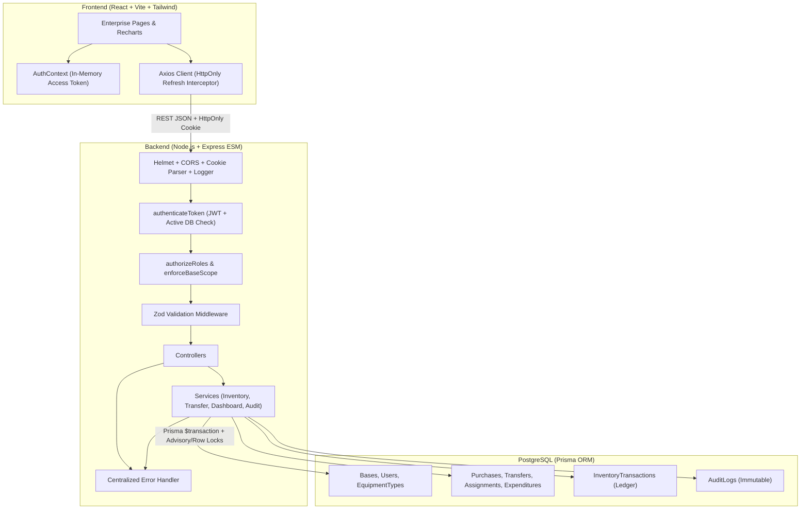
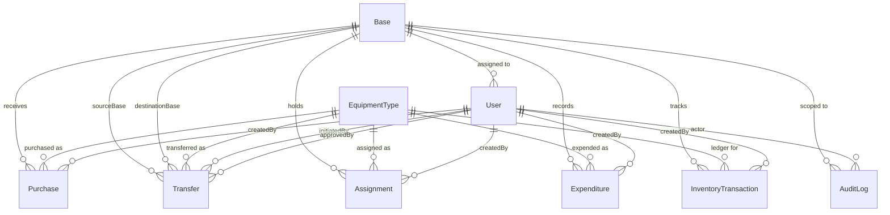

# Military Asset Management System (MAMS)

An enterprise-grade, full-stack logistics and asset accountability platform for tracking military equipment across multiple bases with ledger-backed historical balances, atomic inter-base transfers, strict Role-Based Access Control (RBAC), base-level data isolation, and immutable audit logging.

> *The original project specification prompt has been preserved at [docs/REQUIREMENTS_PROMPT.md](docs/REQUIREMENTS_PROMPT.md).*

---

## 1. Problem Statement & Objectives

Military installations require exact visibility over high-value inventory (vehicles, weapons, ammunition, communications gear) from procurement through inter-base transfers, local unit assignments, and consumption expenditures. Informal spreadsheets or non-transactional CRUD apps risk negative stock, double-counted transfers, stale historical reports, and unauthorized cross-base visibility.

**Core Objectives:**
- Centralized multi-base inventory visibility with base-level isolation.
- Ledger-driven **Opening Balance**, **Net Movement**, **Assigned**, **Expended**, and **Closing Balance** calculations that remain historically accurate across arbitrary date ranges.
- Atomic, concurrency-safe inter-base transfer workflow (`PENDING` -> `APPROVED` -> `IN_TRANSIT` -> `COMPLETED`) with stock reservations and PostgreSQL transaction locking.
- Server-enforced RBAC across `ADMIN`, `BASE_COMMANDER`, and `LOGISTICS_OFFICER` roles.
- Immutable audit logging of authentication events, inventory mutations, and administrative actions.

---

## 2. Technology Stack

| Layer | Technologies |
| --- | --- |
| **Frontend** | React 18, Vite, Tailwind CSS, React Router DOM, Axios, Recharts, React Hook Form, Zod, Lucide React |
| **Backend** | Node.js (ESM), Express.js, Prisma ORM, JWT (`jsonwebtoken`), `bcrypt`, Zod, Helmet, CORS, Cookie Parser |
| **Database** | PostgreSQL (Neon PostgreSQL for dev/test branches, Render PostgreSQL for production) |
| **Testing** | Vitest, Supertest against an isolated PostgreSQL test branch |
| **Deployment** | Frontend on Vercel · Backend & PostgreSQL on Render |

---

## 3. System Architecture



---

## 4. Database Schema & ER Diagram



---

## 5. Inventory Calculation Methodology

All balances are computed dynamically from the `inventory_transactions` ledger and active transfer reservations:

- **Net Movement** = `Purchases + Transfers In - Transfers Out`
- **Closing Balance** = `Opening Balance + Net Movement - Assigned - Expended` (+ admin adjustments if any)
- **Opening Balance**: Sum of all ledger quantities strictly before the selected `startDate` (`occurredAt < startDate`).
- **Stock Reservations**: Transfers in `APPROVED` or `IN_TRANSIT` status reserve stock at the source base (`Available = Completed Balance - Reserved Outgoing`) without altering `Closing Balance` until `COMPLETED`.
- **Concurrency Safety**: Mutations run inside `prisma.$transaction` with PostgreSQL transaction-scoped advisory locks (`pg_advisory_xact_lock`) and `SELECT ... FOR UPDATE` row locks to prevent negative stock, race conditions, and duplicate completions.

---

## 6. User Roles & RBAC Matrix

| Capability | ADMIN | BASE_COMMANDER (Own Base Only) | LOGISTICS_OFFICER |
| --- | :---: | :---: | :---: |
| Global Dashboard & All Bases | Yes | Own Base Only (`403` on others) | Policy-Configurable (`LOGISTICS_GLOBAL_SCOPE`) |
| Manage Bases, Users, Equipment | Yes | No (`403`) | No (`403`) |
| Record & View Purchases | All Bases | View Own Base Only | Yes (Create & View) |
| Inter-Base Transfers | All Actions | View Own Base / Approve Outgoing / Complete Incoming | Initiate, Dispatch, Complete, Cancel |
| Assignments & Expenditures | All Bases | Own Base Only | No (`403`) |
| Audit Logs | Global | Own Base Only | Logistics Entities (`PURCHASE`, `TRANSFER`) |

Detailed permissions are documented in [docs/RBAC_MATRIX.md](docs/RBAC_MATRIX.md).

---

## 7. Prerequisites & Installation

### Prerequisites
- Node.js `v20+` (verified on `v22.17.1`)
- npm `v10+`
- PostgreSQL database (local PostgreSQL or Neon PostgreSQL with separate dev and test branches)

### Install Dependencies

```bash
# Backend
cd backend
npm install

# Frontend
cd ../frontend
npm install
```

---

## 8. Environment Configuration

Never commit `.env` files containing real credentials or secrets.

### Backend (`backend/.env`)
Copy [backend/.env.example](backend/.env.example) (or [backend/.env.development](backend/.env.development) for local dev defaults) to `backend/.env` and configure:
- `DATABASE_URL` — Runtime PostgreSQL connection URL (pooled URL when using Neon)
- `DIRECT_URL` — Direct non-pooled PostgreSQL connection URL for Prisma migrations
- `TEST_DATABASE_URL` — Isolated PostgreSQL branch/database URL for automated tests
- `JWT_SECRET` & `JWT_REFRESH_SECRET` — Strong signing secrets
- `CLIENT_URL` — Allowed frontend origin (e.g., `http://localhost:5173`)
- `LOGISTICS_GLOBAL_SCOPE` — `true` (global logistics) or `false` (home-base restricted)

### Frontend (`frontend/.env.development` / Vercel Env)
Copy [frontend/.env.example](frontend/.env.example) to `frontend/.env.development` (already configured for local dev):
- `VITE_API_BASE_URL` — Backend API base URL (e.g. `http://localhost:5000/api` locally, or your Render API URL in production)

---

## 9. Database Setup, Seeding & Test Accounts

```bash
cd backend

# Generate Prisma Client
npx prisma generate

# Apply migrations to development database
npx prisma migrate deploy

# Apply migrations to isolated test database (example using TEST_DATABASE_URL)
# Override DATABASE_URL and DIRECT_URL in your shell for that single command only

# Seed development data and initial test accounts (development only)
npm run prisma:seed
```

### Initializing the Three Development Test Accounts
When `SEED_ENABLE_DEV_ACCOUNTS=true` and `NODE_ENV` is not `production`, `npm run prisma:seed` reads `SEED_ADMIN_*`, `SEED_COMMANDER_*`, and `SEED_LOGISTICS_*` from environment variables (defined in `backend/.env.development` / `backend/.env`), hashes passwords with `bcrypt` (12 rounds), and provisions:
1. **Admin**: `admin_user` (Global access across all bases)
2. **Base Commander**: `commander_alpha` (Strictly scoped to **Fort Alpha**, Base #1)
3. **Logistics Officer**: `logistics_officer` (Home base **Fort Alpha**, global logistics operations)

> **Security Note:** Development credentials are configured in `.env.development` for local testing only and are never seeded in production (`NODE_ENV=production`). For production admin setup, see [docs/DEPLOYMENT.md](docs/DEPLOYMENT.md).

---

## 10. Running Locally

```bash
# Terminal 1 — Start Express backend (http://localhost:5000)
cd backend
npm run dev

# Terminal 2 — Start Vite React frontend (http://localhost:5173)
cd frontend
npm run dev
```

Verify backend health: `GET http://localhost:5000/api/health`.

---

## 11. Testing & Production Builds

```bash
# Run automated backend integration tests against TEST_DATABASE_URL
cd backend
npm test

# Build frontend for production
cd ../frontend
npm run build
```

Test suites cover Authentication, RBAC & Base Isolation, Inventory Calculations, Transfer Transactions & Concurrency, and Audit Logging. See [docs/TESTING.md](docs/TESTING.md).

---

## 12. Technical Documentation & Deployment

- [System Architecture](docs/ARCHITECTURE.md)
- [Database Schema & Constraints](docs/DATABASE_SCHEMA.md)
- [REST API Reference](docs/API_DOCUMENTATION.md)
- [RBAC Permissions Matrix](docs/RBAC_MATRIX.md)
- [Testing Guide](docs/TESTING.md)
- [Render & Vercel Deployment Guide](docs/DEPLOYMENT.md)
