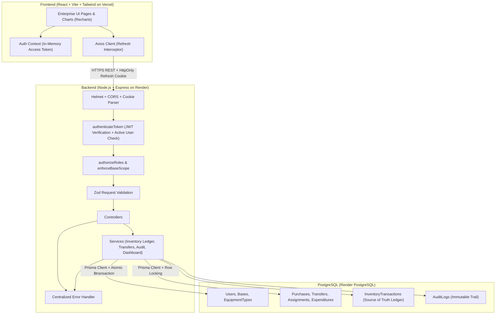

# System Architecture — Military Asset Management System (MAMS)

## 1. Architectural Overview

MAMS is designed as a modular, three-tier monorepo web application with strict separation between presentation (`frontend/`), application/business logic (`backend/`), and relational persistence (`PostgreSQL` via `Prisma ORM`).

- **Frontend (Vercel)**: Single-Page Application built with React 18+, Vite, Tailwind CSS, React Router DOM, Axios, Recharts, React Hook Form, and Zod. Communicates with the backend exclusively via environment-configured REST APIs (`VITE_API_BASE_URL`) using credentialed requests (`withCredentials: true`) for HttpOnly refresh token cookies and in-memory access tokens.
- **Backend (Render)**: Stateless Node.js / Express.js ES Module server implementing layered architecture (`routes -> middleware -> controllers -> services -> Prisma`). All authorization, base-level isolation, stock reservation checks, atomic PostgreSQL transactions, and immutable audit logging are enforced server-side.
- **Database (Render PostgreSQL)**: Normalized relational database using Prisma ORM with foreign keys, check/unique constraints, indexes, and row-level locking (`SELECT ... FOR UPDATE`) for concurrent inventory operations.

## 2. System Architecture Diagram

## 3. Core Design Decisions

### 3.1 Authentication & Session Security
- **Short-lived Access Token (JWT, e.g. 15m)**: Kept in React memory (never `localStorage` or `sessionStorage`) and sent as `Authorization: Bearer <token>`.
- **Refresh Token (JWT, e.g. 7d)**: Stored in an `HttpOnly`, `SameSite` (`Lax` in dev, `None; Secure` in cross-origin prod), `Secure` (in production) cookie scoped to `/api/auth`. A hashed refresh token is stored on the `User` record (or session store) to allow immediate revocation on logout or user deactivation.
- **Authoritative Re-verification**: On every protected request, `authenticateToken` verifies the JWT signature and loads the user's current `role`, `baseId`, and `isActive` status from PostgreSQL so deactivated accounts or role changes take effect immediately.

### 3.2 Base-Level Data Isolation
- `BASE_COMMANDER` accounts are bound to a single `baseId` (e.g., Fort Alpha).
- Any query parameter, URL parameter, or request body field specifying a different `baseId` is rejected with `403 Forbidden`.
- List queries automatically filter by `user.baseId` on the server.
- Transfer endpoints verify that a Base Commander is only viewing or acting on transfers involving their own base, according to role transition rules.

### 3.3 Inventory Calculation & Concurrency Control
- **Ledger as Source of Truth**: `InventoryTransaction` records every completed stock movement (`PURCHASE`, `TRANSFER_IN`, `TRANSFER_OUT`, `ASSIGNMENT`, `ASSIGNMENT_RETURN`, `EXPENDITURE`, `ADJUSTMENT`) with an `occurredAt` timestamp.
- **Period Calculation**:
  - `Opening Balance` = Sum of ledger movements where `occurredAt < startDate`
  - `Net Movement` = `Purchases + Transfers In - Transfers Out` within `[startDate, endDate]`
  - `Assigned` = Net assignments (`ASSIGNMENT` minus `ASSIGNMENT_RETURN`) within `[startDate, endDate]`
  - `Expended` = `EXPENDITURE` within `[startDate, endDate]`
  - `Closing Balance` = `Opening Balance + Net Movement - Assigned - Expended + Adjustments`
- **Stock Reservations**: Transfers in `APPROVED` or `IN_TRANSIT` status reserve stock at `sourceBaseId` without modifying the completed ledger until `COMPLETED`.
- **Concurrency Safety**: All stock-changing mutations execute inside `prisma.$transaction` using PostgreSQL `SELECT ... FOR UPDATE` locks on the `(baseId, equipmentTypeId)` pair (or transfer record) to eliminate race conditions, negative stock, and duplicate transfer completion.

## 4. Frontend Navigation & Pages

1. `/login` — Enterprise login screen
2. `/unauthorized` — 403 access denied screen
3. `/` (`/dashboard`) — Role-specific operational dashboard with interactive Net Movement breakdown modal and Recharts visualizations
4. `/inventory` — Base/category/date-filtered inventory ledger summary table
5. `/purchases` — Purchase recording and history
6. `/transfers` — Inter-base transfer initiation, approval, dispatch, completion, rejection, cancellation
7. `/assignments` — Asset assignment creation, active/returned tracking
8. `/expenditures` — Expenditure recording and history
9. `/reports` — Consolidated operational reports & exportable tables
10. `/audit-logs` — Immutable audit log viewer (role-scoped)
11. `/users` — User & role management (Admin only)
12. `/bases` — Base management (Admin only)
13. `/equipment` — Equipment catalog management (Admin only)
14. `/settings` — Profile & theme preferences
