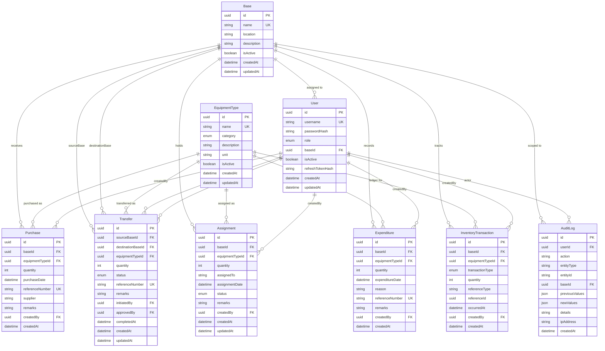

# Database Schema — Military Asset Management System (MAMS)

## 1. Entity-Relationship Diagram

## 2. Enums & Constraints

- **Role**: `ADMIN`, `BASE_COMMANDER`, `LOGISTICS_OFFICER`
- **EquipmentCategory**: `VEHICLE`, `WEAPON`, `AMMUNITION`, `OTHER`
- **TransferStatus**: `PENDING`, `APPROVED`, `IN_TRANSIT`, `COMPLETED`, `REJECTED`, `CANCELLED`
- **AssignmentStatus**: `ACTIVE`, `RETURNED`
- **TransactionType**: `PURCHASE`, `TRANSFER_IN`, `TRANSFER_OUT`, `ASSIGNMENT`, `ASSIGNMENT_RETURN`, `EXPENDITURE`, `ADJUSTMENT`
- **PostgreSQL CHECK Constraints** (enforced in SQL migration):
  - `purchases.quantity > 0`
  - `transfers.quantity > 0` AND `transfers.source_base_id <> transfers.destination_base_id`
  - `assignments.quantity > 0`
  - `expenditures.quantity > 0`
  - `inventory_transactions.quantity <> 0`

## 3. Stock Reservation & Ledger Rules

1. **Completed Balance (Physical On-Hand)**: Sum of `InventoryTransaction.quantity` for `(baseId, equipmentTypeId)` up to a given timestamp.
2. **Reserved Stock**: Sum of `Transfer.quantity` where `sourceBaseId = baseId`, `equipmentTypeId = equipmentTypeId`, and `status IN ('APPROVED', 'IN_TRANSIT')`.
3. **Available Stock**: `Completed Balance - Reserved Stock`. Must always remain `>= 0`.
4. **Pending Transfers**: Do not reserve or modify stock. Available stock is still validated at initiation and re-validated at approval inside a transaction lock.
5. **Completion Atomicity**: Transitioning `IN_TRANSIT -> COMPLETED` (or `APPROVED -> COMPLETED` if allowed? Workflow requires `PENDING -> APPROVED -> IN_TRANSIT -> COMPLETED`!) writes `TRANSFER_OUT` (`-quantity`) at `sourceBaseId` and `TRANSFER_IN` (`+quantity`) at `destinationBaseId` with the same `completedAt` timestamp inside a single `prisma.$transaction`.
